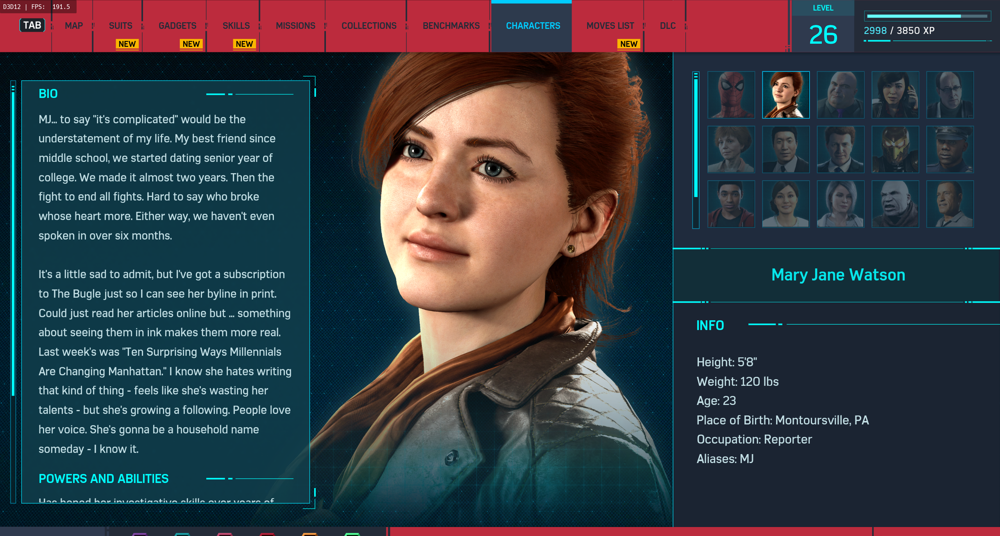
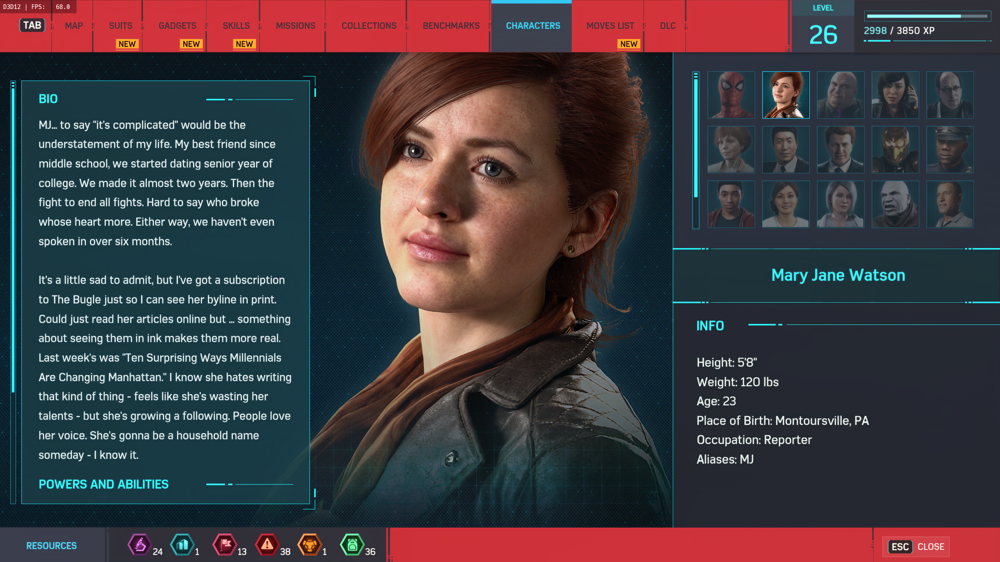

# DLSS-NR on Intel Arc (native DirectX 12)

NVIDIA's DLSS-NR "neural rendering" network (the one-step diffusion pass behind DLSS 5, a 71-block
U-Net with 145.8 M parameters) running natively on Direct3D 12 on an **Intel Arc B580**, plus a
drop-in bridge that applies it to the frames of a DirectX 12 game at `Present`. No CUDA, no Vulkan,
no NVIDIA GPU.

| NR off | NR on |
| --- | --- |
|  |  |

*Marvel's Spider-Man Remastered, 2560x1440, Arc B580, through OptiScaler.*

> [!IMPORTANT]
> **No NVIDIA weights or binaries are in this repository.** The network needs weights that you
> extract yourself from **your own** `nvngx_dlssnr.dll`. NVIDIA's DLSS licence terms may forbid
> that; the result is for your local use only and must never be committed or shared. Everything
> derived from it lives in the git-ignored `work/` folder (and in the game folder you install to).

> [!WARNING]
> **Anti-cheat:** a proxy `dxgi.dll` or an injected ASI plugin is exactly what anti-cheat systems
> look for. Do not use this in online games or in games with anti-cheat (Easy Anti-Cheat,
> BattlEye, ACE, ...): it can get your account banned. **Single-player games without anti-cheat only.**

This is an experimental research project. It works in real games, but it is not a finished
product: see [Known issues](#known-issues) and [Help wanted](#help-wanted).

## Contents

- [Status](#status)
- [Requirements](#requirements)
- [Setup](#setup) (dependencies, build, weights, checks)
- [Installing into a game](#installing-into-a-game)
- [Settings](#settings) and [recommended presets](#recommended-presets)
- [Known issues](#known-issues) / [Help wanted](#help-wanted)
- [Reporting a problem: frame captures](#reporting-a-problem-frame-captures)
- [How it works](#how-it-works) / [Repository map](#repository-map)
- [Credits and licences](#credits-and-licences)

## Status

| | |
| --- | --- |
| Network | Ported to PyTorch (`tools/hnet/model.py`), **bit-exact** against the numpy reference of [Uzbekunknown/dlss-nr-on-intel](https://github.com/Uzbekunknown/dlss-nr-on-intel) on all 71 blocks |
| GPU path | Native: fused HLSL kernels + DirectML GEMM operators (XMX) recorded into the game's own command queue; ONNX Runtime only as a fallback |
| Accuracy (real weights) | `precision=accurate` (the vendor's FP8 E4M3 roundings): correlation of the network's effect with the reference **0.977**; `precision=fast` (default): 0.85 |
| Games tested | Stellar Blade (Unreal Engine, 1440p), Marvel's Spider-Man Remastered (with OptiScaler + Streamline), both through OptiScaler as an ASI plugin |
| GPU tested | Intel Arc B580, driver 32.0.101.9150, Windows 11 |

GPU time of the whole filter on an Arc B580 (`precision=fast`, 2560x1440 output):

| `render_scale` | network field | `interval=1` | `interval=2` | `interval=4` |
| --- | --- | --- | --- | --- |
| 0.3 | 768x448 | 13.4 ms | — | — |
| 0.4 | 1024x576 | 20.1 ms | 11.0 ms | 6.1 ms |
| 0.5 | 1344x768 | 36.0 ms | 19.2 ms | 10.1 ms |

At 1920x1080 with `render_scale=0.5` (field 960x576) `interval=1` takes 18.4 ms. The cost follows
the network *field* (the downscaled frame the network sees), not the output resolution.
`interval=N` spreads one network run over N frames (see [Known issues](#known-issues)).

## Requirements

- Windows 10/11 x64, an **Intel Arc** GPU (developed and tested on the B580; other Xe2/Xe-HPG GPUs
  are untested) with a recent driver.
- A DirectX 12 game, single-player, without anti-cheat.
- Your own `nvngx_dlssnr.dll`, version **310.8.0.0 or newer** (shipped with games and NVIDIA
  packages that include DLSS neural rendering). This project does not ship or download it.
- For building: Python 3.12, Git, PowerShell. The C++ compiler (Zig), CMake and Ninja come from pip.

## Setup

All commands run in PowerShell from the repository root.

### 1. Python packages

```powershell
python -m pip install numpy safetensors torch onnx onnxruntime-directml onnxscript cmake ninja ziglang pillow
$env:PYTHONIOENCODING = "utf-8"   # the exporters print characters the default console code page cannot
```

### 2. Third-party packages (not in the repository)

The build expects these under `third_party/` (all git-ignored):

| Package | Version | Path | Needed for |
| --- | --- | --- | --- |
| Microsoft.ML.OnnxRuntime.DirectML (NuGet, MIT) | 1.24.4 | `third_party/onnxruntime/extracted` | build, game drop-in (`ort\onnxruntime.dll`) |
| Microsoft.AI.DirectML (NuGet) | 1.15.4 | `third_party/directml/extracted` | build, game drop-in (`ort\DirectML.dll`) |
| Microsoft.Direct3D.DXC (NuGet) | 1.8.2407.12 | `third_party/dxc/extracted` | only when you change HLSL (the compiled shaders are committed) |
| [Uzbekunknown/dlss-nr-on-intel](https://github.com/Uzbekunknown/dlss-nr-on-intel) (Apache-2.0) | `2f90064` | `third_party/refs/dlss-nr-on-intel` | the numpy reference the checks compare against |
| [OptiScaler](https://github.com/optiscaler/OptiScaler) release | 0.9.4 | `third_party/optiscaler/pkg` (extracted release) | only for `tools/install_optiscaler_intel.ps1` |

```powershell
$packages = @{
    "onnxruntime" = "Microsoft.ML.OnnxRuntime.DirectML/1.24.4"
    "directml"    = "Microsoft.AI.DirectML/1.15.4"
    "dxc"         = "Microsoft.Direct3D.DXC/1.8.2407.12"
}
foreach ($name in $packages.Keys) {
    New-Item -ItemType Directory -Force "third_party\$name" | Out-Null
    Invoke-WebRequest "https://www.nuget.org/api/v2/package/$($packages[$name])" -OutFile "third_party\$name\package.zip"
    Expand-Archive "third_party\$name\package.zip" "third_party\$name\extracted" -Force
}
git clone https://github.com/Uzbekunknown/dlss-nr-on-intel third_party/refs/dlss-nr-on-intel
git -C third_party/refs/dlss-nr-on-intel checkout 2f90064
```

### 3. Build

```powershell
cmake -S . -B build -G Ninja      # uses Zig's clang through tools\zig-cxx.cmd
cmake --build build
```

This builds `build\dlss_nr_dx12_poc.exe` (the standalone runner, checks and benchmarks),
`build\test_bridge.exe` and the game bridge `dist\game-drop-in\dxgi.dll`. After changing any
`src/compute/*.hlsl`, run `python tools\build_neural_shaders.py` (needs DXC) and build again.

### 4. Weights (from your own DLL)

```powershell
.\tools\get_weights.ps1 -Dll "C:\path\to\your\nvngx_dlssnr.dll" -Models
```

This clones [MLX-DLSS](https://github.com/iamwavecut/MLX-DLSS) (Apache-2.0, pinned commit) into
`work\`, extracts the 649 logical tensors into `work\mlxw\dlssnr-logical.safetensors`, checks their
shapes and then builds everything the runner needs (`tools\hnet\make_models.py --weights real`): the
weight blob `work\onnx\hnet-ends_nq-exp.bin` (~300 MB), reference dumps and golden frames.
**Every one of these files contains NVIDIA's weights: keep them local.**

No DLL at hand? `python tools\hnet\make_models.py --weights synthetic` makes random stand-ins (no
NVIDIA data) and `--synthetic` runs on them: the picture is meaningless, but the plumbing,
the checks and the timings are real.

### 5. Checks and benchmark

```powershell
python tools\run_neural_checks.py --real     # or without --real on the synthetic weights
.\build\dlss_nr_dx12_poc.exe --neural --precision fast --render-scale 0.5 --interval 4 --bench 2560x1440 --output-dir work
```

`run_neural_checks.py` must end with `ALL PASS`: the PyTorch port bit-exact against the reference,
the GPU kernels against PyTorch, the C++ graph against the reference's golden frames, the
multi-frame (`interval`) paths, the stabiliser and the game bridge on a real swapchain. Run
benchmarks with nothing else using the GPU (games, video, browsers with hardware acceleration).

## Installing into a game

### 1. Package

```powershell
.\tools\package_neural_dropin.ps1 -IncludeModels
```

`dist\game-drop-in\` then holds:

| | |
| --- | --- |
| `dxgi.dll` | the bridge as a proxy `dxgi.dll` |
| `plugins\DLSS_NR_DX12.asi` | the same bridge as an OptiScaler ASI plugin |
| `ort\` | `onnxruntime.dll`, `onnxruntime_providers_shared.dll`, `DirectML.dll` |
| `models\neural\hnet-ends_nq-exp.bin` | **your** weight blob (only with `-IncludeModels`; never share this folder) |
| `dlss_nr_neural.ini` | the settings (see below) |

### 2a. With OptiScaler (recommended on Intel Arc)

OptiScaler lets the game use XeSS and owns `dxgi.dll`; the filter loads as its ASI plugin.

- **OptiScaler not installed yet:** put the OptiScaler 0.9.4 release in
  `third_party\optiscaler\pkg` and run

  ```powershell
  .\tools\install_optiscaler_intel.ps1 -GamePath "D:\Games\SomeGame\Binaries\Win64" -WithNrFilter
  ```

  (the folder of the game's `.exe`). It backs up what it replaces and writes
  `uninstall_optiscaler_intel.ps1` into the game folder. `-FrameGen` also enables XeSS frame generation.
- **OptiScaler already installed:** copy `plugins\DLSS_NR_DX12.asi`, `ort\`, `models\neural\` and
  `dlss_nr_neural.ini` from `dist\game-drop-in` next to the game's `.exe` and set
  `LoadAsiPlugins=true` in `OptiScaler.ini`.

### 2b. Without OptiScaler

Copy `dxgi.dll`, `ort\`, `models\neural\` and `dlss_nr_neural.ini` next to the game's `.exe`.
(If the game or another mod already uses a `dxgi.dll`, use the OptiScaler route instead.)

### 3. Play

- The first frames go out unprocessed while the filter builds its GPU resources in the
  background (about 0.5–1 s); then it runs every frame.
- **F11** turns the filter on and off (with a beep). `Shift+F11` cycles `interval` 1 → 2 → 4 and
  `Ctrl+F11` the warp mode, for A/B tests.
- `dlss_nr_neural.ini` is **re-read when you save it while the game runs**: change a setting, save,
  and it applies within half a second (logged, with a beep). No F keys needed. `precision`,
  `model_tag` and `synthetic` only take effect after a restart.
- `dlss_nr_dx12_bridge.log` (next to the `.exe`) records the resolution, the network field, the GPU
  time of the filter and every setting change.

To uninstall, delete the copied files (or run `uninstall_optiscaler_intel.ps1` for the OptiScaler route).

## Settings

`dlss_nr_neural.ini`, section `[neural]`:

| Key | Default | Meaning |
| --- | --- | --- |
| `render_scale` | 0.5 | Fraction of the back buffer the network sees. The main cost and quality knob: the effect looks most like DLSS 5 when faces are large in the network's view (0.4–0.5 and up; close-ups and photo mode benefit most) |
| `intensity` | 1.0 | 0 = the game's frame, 1 = the network's picture (up to 2 extrapolates) |
| `profile` | standard | `standard`, `natural`, `cinematic`, `neutral` (the network's control inputs) |
| `interval` | 1 | 1–4: one network run spread over that many frames, so about 1/N of its GPU time per frame. With N > 1 the last result is moved along the picture's motion: see [Known issues](#known-issues) |
| `warp` | 1 | `interval` > 1: move the last correction along the motion (0: show it where it was) |
| `warp_model` | 1 | ... move its local colour model, so its edges follow this frame's picture (0: move the correction as it is) |
| `warp_blend` | 0.5 | ... blend a new correction with the last one (less flicker; 1 = the new one alone, less lag) |
| `warp_pyramid` | 1 | ... also search the motion coarsely over ±96 field pixels (fast or reversing camera) |
| `warp_chain` | 0 | ... follow the motion frame to frame up to the frame the correction came from (+0.4–0.6 ms) |
| `warp_fade_start`, `warp_fade_full` | 2, 6 | ... from / to this speed (field pixels per frame) the moved detail fades out (`warp_fade_full=0`: never) |
| `warp_fade_to` | regional | ... to a smooth regional correction (`regional`) or to the game's own picture (`none`) |
| `precision` | fast | `accurate`: the vendor's FP8 roundings, closest to the real DLSS-NR, about 20 % slower; flickers without `stabilize` |
| `stabilize` | 0.05 | Averages the correction over frames along the motion (against flicker and shimmer); 0 = off |
| `stabilize_tolerance` | 1.0 | Colour change still averaged (raise if a still scene shimmers, lower if something drags) |
| `stabilize_motion` | 0.5 | Least weight of a new result where anything moves (1 = no averaging there) |
| `temporal` | 0 | Feed the previous output back into the network. Keep 0: without the game's motion vectors it smears motion |
| `capture` | 0 | Saved as a new number N > 0 while playing: records the next N frames (see [frame captures](#reporting-a-problem-frame-captures)) |
| `model_tag` | nq-exp | Numerics of the ONNX fallback (`nq-exp`, `vk-pwl`) |
| `synthetic` | 0 | 1 = use the synthetic stand-in weights (plumbing tests only) |

### Recommended presets

Measured at 2560x1440 on an Arc B580; the game's own frame time comes on top.

| Preset | Settings | Filter GPU time | Trade-off |
| --- | --- | --- | --- |
| **Clean** (no ghosting) | `interval=1`, `render_scale=0.3` | ~13 ms | The network runs on every frame: no lag, no ghosting. Weakest effect on small faces |
| **Balanced** | `interval=2`, `render_scale=0.4`, `warp_blend=1` | ~11 ms | Some ghosting and light flicker under a fast camera |
| **Fast** | `interval=4`, `render_scale=0.5` | ~10 ms | Strong effect when still; visible ghosting under a fast camera |
| **Photo mode / close-ups** | `interval=1`, `render_scale=0.5` (or higher) | ~36 ms | Strongest, most DLSS-5-like effect; not for gameplay |

## Known issues

- **Ghosting with `interval` > 1 under a fast camera.** With `interval=4` the correction on screen
  was computed from a frame 3–6 frames old and is moved along the picture's motion, found by block
  matching on the picture itself. Frame captures from Spider-Man Remastered show why that breaks
  under a fast camera: the game's own motion blur / TAA removes more than half of the picture's
  detail while the camera moves, so the network's correction for those frames is different, and
  nothing computed from an older frame fits (moved correction and regional model alike, whatever
  the motion vectors). `interval=2` halves the error, `interval=1` has none. The real fix is
  probably the game's own motion vectors (see [Help wanted](#help-wanted)).
- **Speed.** The 32-channel full-resolution blocks are limited by plain FP32 ALU throughput; the
  XMX matrix engines are only used through DirectML GEMMs for the wider blocks.
- **`temporal=1`** smears moving pictures (no motion vectors), and the network's history path does
  not yet match the reference with the real weights: keep `temporal=0`.
- **`precision=accurate`** is the most faithful, but its FP8 roundings make the correction jump
  between nearly identical frames (flicker); it needs `stabilize` (default 0.05).
- **HDR** swapchains (scRGB FP16 / HDR10) are clamped to [0,1]: untested and not correct for HDR content.
- The effect is strongest where faces are large in the network's view; at low `render_scale` small
  faces barely change.

## Help wanted

Contributions, measurements and ideas are welcome, especially:

1. **Game motion vectors.** OptiScaler (and Streamline) already receive the game's motion vectors
   and depth for the upscaler. Using them for the `interval` warp would remove most of the ghosting
   and would make `temporal=1` usable.
2. **XMX from compute.** The fused 32-channel kernels (~45 % of the time) are FMA-bound. Cooperative
   vectors were dropped from SM 6.9; SM 6.10 `linalg` is not yet supported on Intel. The driver
   exposes `VK_KHR_cooperative_matrix`, so a Vulkan compute path with D3D12 interop might be 2–4x
   faster for those blocks.
3. **Other Intel GPUs** (A-series, Lunar Lake 140V, Xe3) and other games: logs and timings.
4. **The history (temporal) path** with the real weights, and **HDR** output.

When reporting, include `dlss_nr_dx12_bridge.log`, your `dlss_nr_neural.ini`, the GPU and driver
version, and if possible a frame capture.

## Reporting a problem: frame captures

The bridge can record exactly what it saw and showed:

1. While playing, set `capture=200` in `dlss_nr_neural.ini` and save, then go straight back to the
   game and reproduce the problem (200 frames ≈ 3–4 s).
2. A beep marks the end. The frames are in `<game folder>\dlss_nr_capture\<date-time>\`:
   `in_NNNN.raw` (the game's picture before the filter), `out_NNNN.raw` (what was shown),
   RGBA8 rows, and `meta.txt` (size and settings). About 30 MB per frame at 1440p.
3. To capture again, save a different number.

These frames contain the game's picture only (no weights), but they are large; share a short
range if asked. Offline, the runner replays a capture through the network at any setting and
compares it with running the network on every frame:

```powershell
.\build\dlss_nr_dx12_poc.exe --neural --precision fast --no-temporal --render-scale 0.5 --interval 4 `
    --interval-sequence "<game folder>\dlss_nr_capture\<date-time>" --interval-frames 18,66 --output-dir work
```

It prints, per frame, how far the shown correction is from the network's own result on that
frame; `--interval-dump DIR` also writes the corrections as PFM images.

## How it works

```
back buffer ─► CSNeuralPre: 16 feature channels on the mirrored, downscaled field
           ─► blocks 0-4, 66-70 (32 ch):  one fused HLSL kernel per 8x8 attention window
           ─► blocks 5-22, 48-65 (64-256 ch): DirectML GEMMs (XMX) + HLSL gate / residual / window attention
           ─► blocks 23-47 (512 ch, ViT):  DirectML GEMMs + HLSL attention (window and global)
           ─► [interval > 1: the last complete result moved along the picture's motion]
           ─► CSNeuralPost: the network's residual, upscaled, over the full-resolution frame ─► back buffer
```

The whole network (~570 dispatches) is recorded once per resolution into reusable command lists
and executed on the game's own DIRECT queue around `Present`, so the filter costs almost no CPU.
Numerics follow the vendor's graph; `precision=fast` drops the FP8 roundings and uses a plain
softmax for speed.

## Repository map

| | |
| --- | --- |
| `src/neural/` | the network on D3D12: `NeuralGraph` (passes, interval, warp), `HybridEnds` (kernels and weight blob), `DmlGemmSet` (DirectML GEMMs), ONNX Runtime fallback, the `--neural` runner (`neural_app.cpp`) |
| `src/compute/neural_*.hlsl` | pre/post passes, warp and the network's kernels; compiled into `src/neural/embedded_neural_dxil.h` by `tools/build_neural_shaders.py` |
| `src/bridge/` | the `dxgi.dll` / ASI proxy and the per-`Present` bridge (settings reload, hotkeys, capture) |
| `src/dx12/`, `src/benchmark/` | device, queues, resources; early capability and GEMM benchmarks |
| `tools/hnet/` | PyTorch port, reference oracle, exports, comparisons, profiling |
| `tools/` | weights extraction, model building, shader build, packaging, OptiScaler installer, the check suite |
| `tests/` | swapchain bridge test, image and GEMM tests |
| `docs/` | architecture and decisions of the early proof of concept |

## Credits and licences

- The recovered graph and its numerics: [Uzbekunknown/dlss-nr-on-intel](https://github.com/Uzbekunknown/dlss-nr-on-intel)
  (Apache-2.0). `tools/hnet/model.py` ports its `nr_model.py`, which ports MLX-DLSS's `model.py`.
- Weight extraction, logical tensor shapes and feature construction: [iamwavecut/MLX-DLSS](https://github.com/iamwavecut/MLX-DLSS) (Apache-2.0).
- Related work consulted: [geladons/DLSS5_INTEL](https://github.com/geladons/DLSS5_INTEL),
  [OUCO86/dlss-nr-on-a770](https://github.com/OUCO86/dlss-nr-on-a770),
  [gggz114514-oss/dlss5nr-b580-intelarc](https://github.com/gggz114514-oss/dlss5nr-b580-intelarc).
- [ONNX Runtime](https://github.com/microsoft/onnxruntime) (MIT), DirectML and DXC (Microsoft),
  [OptiScaler](https://github.com/optiscaler/OptiScaler) for the XeSS route and ASI loading.

The code in this repository is licensed under the terms in [LICENSE](LICENSE).

DLSS, DLSS 5, Neural Rendering, NGX and `nvngx_dlssnr.dll` are trademarks or property of NVIDIA
Corporation. Game screenshots are © their respective owners and shown for comparison only. This
project is not affiliated with or endorsed by NVIDIA, Intel or any game publisher.
